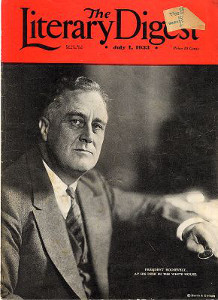
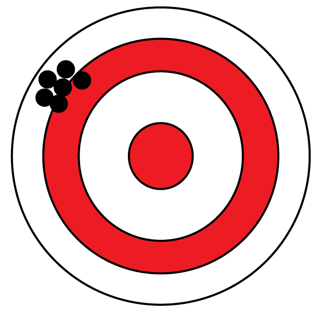
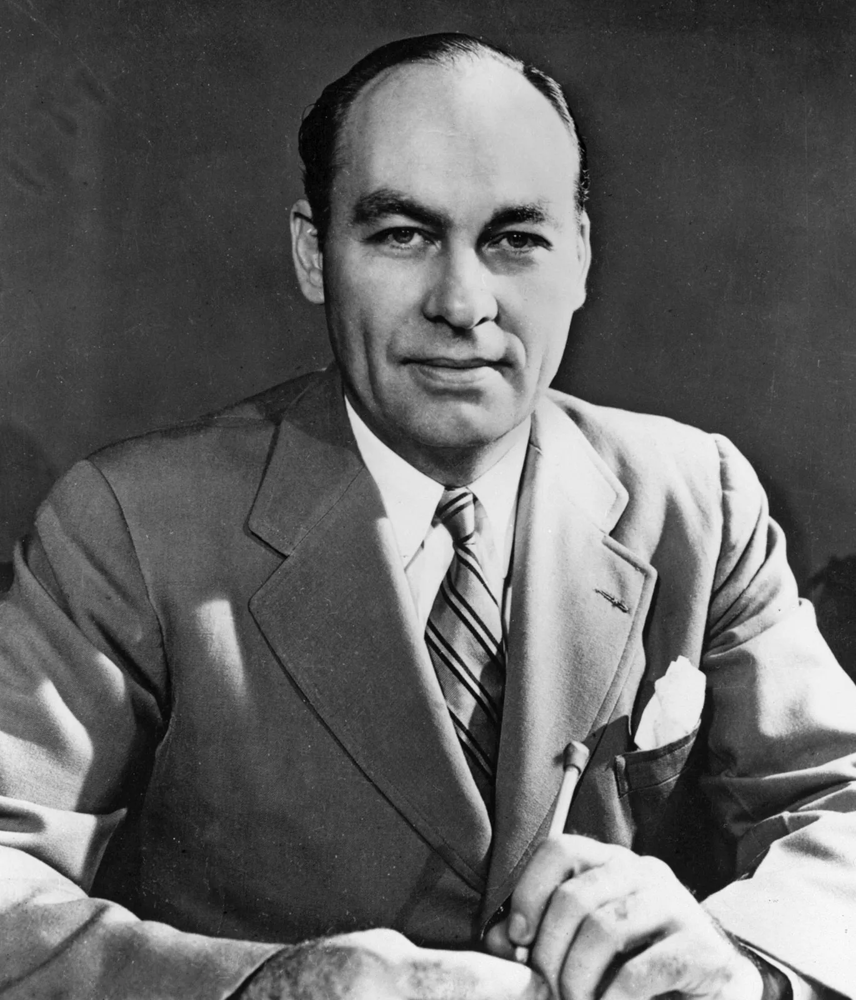
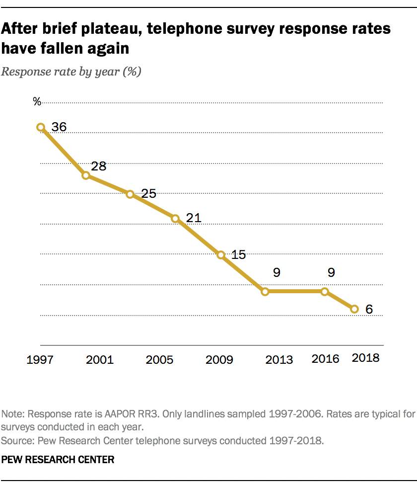



## We have been focusing on **causal inference**

*Does attending a training cause more women to run for office?*

```{r}
library(knitr)
library(kableExtra)
group <- c(rep("Attended training", 3), rep("Did not attend", 3), "")
names <- c("Olivia", "Katie", "Ashlynd", "Camille", "Christina", "Ivy", "Fraction running")
attended <- c("Ran for office", "Ran for office", "Ran for office", "???", "???", "???", "3/3")
didnt <- c("???", "???", "???", "Ran for office", "Did not run", "Did not run", "1/3")
kable(cbind(names, group, attended, didnt),
      col.names = c("Person", "Treatment", "Attended", "Did not attend"),
      align = "cccc") %>%
  column_spec(1, width = "1.5cm") %>%
  column_spec(2, width = "1.8cm") %>%
  column_spec(3, color = c("white", "white", "white", "black", "black", "black", "black"), background = c("green", "green", "green", "#FFFFFF00", "#FFFFFF00", "#FFFFFF00", "#FFFFFF00"), width = "6cm") %>%
  column_spec(4, color = c("black", "black", "black", "white", "white", "white", "black"), background = c("#FFFFFF00", "#FFFFFF00", "#FFFFFF00", "green", "grey20", "grey20", "#FFFFFF00"), width = "6cm") %>%
  row_spec(7, color = "white") %>%
 collapse_rows(columns = 2, valign = "middle") %>%
  add_header_above(c(" " = 2, "Potential outcomes" = 2)) %>%
  kable_styling(font_size = 25)
```

:::{.fragment}
Main estimand of interest: the **average treatment effect**
:::

## From causal inference to *describing populations*

:::{.columns}
:::{.column width=45%}
```{r}
library(dplyr)
names <- c("Sally", "Wei", "Jose", "Michelle", "....", "158,383,403rd voter", "Average")
trump <- c("1", "0", "?", "?", "....", "?", "0.498")

kable(cbind(names, trump),
      col.names = c("Person", "Supports Trump?"),
      align = "cc") %>%
  column_spec(1, width = "5cm") %>%
  column_spec(2, width = "4cm") %>%
  row_spec(7, bold = TRUE) %>%
  kable_styling(font_size = 25)
```
:::
:::{.column width=55%}
- Often surveying only a few hundred people to make inferences about millions
- As with causal questions, we are trying to infer missing info
- Same concepts, new applications
:::
:::

## The importance of random sampling

:::{.columns}
:::{.column width=35%}

:::
:::{.column width=65%}
- 1936: *Literary Digest* wanted to predict the presidential election
- They surveyed **2.2 million** subscribers...
- ...and confidently predicted a landslide victory for Alf Landon over FDR
:::
:::

## A reminder about bias 

:::{.columns}
:::{.column width=40%}

:::
:::{.column width=60%}
- A big sample will reduce **noise**
- But there could still be significant **bias**
- What kind of people subscribed to *Literary Digest?*
  - Rich people.
- *Literary Digest* fell victim to **sampling bias.**

:::
:::

## George Gallup conducted another poll

:::{.columns}
:::{.column width=45%}

:::
:::{.column width=55%}
- Gallup surveyed just a few thousand people
- But he made sure this sample closely resembled the voting population
- And predicted FDR's victory within 6 percentage points (bad now; good then!)
:::
:::

## The value of randomness

- To infer causality, we need some kind of experiment with **random assignment to treatment**
  - In effect, we are randomly sampling from people's potential outcomes
- To make inferences about public opinion, we need **random sampling** to ensure a **representative** sample
  - Just like in an experiment!
  
## Two sources of bias in descriptive surveys

- **Sample selection bias:** the kind of people selected into the sample are systematically different from the population (*e.g.,* the *Literary Digest* sample)
- **Non-response bias:** the kind of people who *agree to respond* to the survey are systematically different from the population sampled (*e.g.,* "shy Trump voters")

## A toy example

```{webr}
suppressMessages(library(dplyr))

# You don't need to learn how to code this part.
# Make fake datasets
wealthy <- data.frame(wealthy = 1,
                      supports.tax.increase = c(0,0,0,0,0,0,0,0,0,1))
working.class <- data.frame(wealthy = 0,
                            supports.tax.increase = c(1,1,1,1,1,1,1,1,1,0))

# One overall dataset. This is our population we want to learn about.
everyone <- rbind(wealthy, working.class)
everyone
```

## Who supports the tax increase?

```{webr}
# true value
mean(everyone$supports.tax.increase)

# a random sample of everyone
a.random.sample <- sample_n(everyone, 10)
mean(a.random.sample$supports.tax.increase)

# a non-random sample
#non.random.sample <- rbind(sample_n(wealthy, 9), sample_n(working.class, 1))
#mean(non.random.sample$supports.tax.increase)
```

## Polls are broken

:::{.columns}
:::{.column width=60%}
- Polls used to predict elections fairly well, but not anymore
- **Sample selection bias** has gotten worse --- random digit dialing no longer yields a representative sample
- **Non-response bias** has gotten worse --- the <6% of people who answer surveys are kinda weird (complimentary)
:::
:::{.column width=40%}
:::{.fragment}

:::
:::
:::

## Weights help... kind of

```{r}
group <- c("Wealthy", "Working class")
population <- c("50%", "50%")
sample <- c("75%", "25%")
weight <- c("1", "3")

kable(cbind(group, population, sample, weight),
      col.names = c("", "% in population", "% in sample", "Weight"),
      align = "lccc") %>%
  column_spec(1, width = "5cm") %>%
  column_spec(2, width = "3.5cm") %>%
  column_spec(3, width = "3.5cm") %>%
  column_spec(4, width = "2.5cm") %>%
  kable_styling(font_size = 25)
```

- We *upweight* individuals with characteristics that are underrepresented in our data relative to the population
- We may *downweight* individuals with overrepresented characteristics
- Then we can use `weighted.mean()`
- But we still have to assume there are no *omitted variables* (*e.g.,* education)

## This week's data

- The *Cooperative Election Survey*
- Surveys tens of thousands of people before and after each national election
- Surveys are conducted online by YouGov
- YouGov invites as many people as it can, then weights the data to try to match the population on race, gender, education, income, etc.

## The 2020 CES data

```{r}
vars <- data.frame(
  Variable = c(
    "vvweight", "college", "medicare_expand",
    "repeal_aca", "regulate_carbon", "prefertrump"
  ),
  Description = c(
    "Survey weight based on validated voters in 2016",
    "Whether the person went to college (0 = no; 1 = yes)",
    "Whether the person favors expanding Medicare, the medical program for people over 65 (0 = no; 1 = yes)",
    "Whether the person favors repealing the Affordable Care Act, or \"Obamacare\" (0 = no; 1 = yes)",
    "Whether the person favors regulations on carbon emissions (0 = no; 1 = yes)",
    "Whether the person prefers Trump to win the 2020 presidential election (0 = no; 1 = yes)"
  )
)

kable(vars, format = "html", col.names = c("Variable", "Description")) %>%
  kable_styling(font_size = 18, full_width = FALSE) %>%
  column_spec(1, monospace = TRUE, width = "4cm") %>%
  column_spec(2, width = "11cm")
```

## Using weights

```{webr}
data <- read.csv("cces2020_pre.csv")

# How many people went to college in this dataset? (32% of American adults)
mean(data$college)

# How many people prefer Trump (prefertrump)? (he won 46.9% of the vote)
```

## A cautionary tale

- Weights are based on things that have happened in the past
- Using them to predict the future is risky
- Still have to worry about omitted variable bias

## Two main takeaways

- Random sampling follows the same logic as random assignment
  - A small, random sample is better than a large, non-random one
- When randomization fails, weighting is the next best thing
  - But we can never be sure we've weighted on all the things that matter
  
# Notebook time!