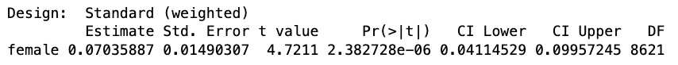



## Upcoming deadline

- Final project first draft report due a week from tomorrow (11/20)
- This is a **solo** assignment
- But you may *clean* your dataset as a group

## [What goes into the research report](https://docs.google.com/document/d/1Z8P7PRylnem_80WCK1jyrQAhdzVqMWVq9F9EQz_xbDE/edit?usp=sharing) {.smaller}

1. A description of your hypothesis
2. A description of your research design
3. A description of the sample: who is your average study participant?
  - `mean()` and `table()` will be useful here
4. At least three different statistical tests/procedures
  - Differences-in-means (whole dataset and/or subsets; each counts as 1)
  - Regressions (you'll learn this on Tuesday!)
  - `mean()`, `subset()`, `table()`, and `ggplot()` are not statistical tests/procedures
5. Explanations of each of your statistical tests
6. An interpretation of the results and what they indicate about your hypothesis
7. An explanation of the limitations of your study (types of bias?)

# 10-minute check in: how are your data looking?

## Descriptive hypotheses

- On Tuesday, we learned how to look at *levels* of variables
  - *e.g.,* what percent of people support repealing the ACA?
- Today, we will examine **descriptive hypotheses:** hypotheses about differences between groups
  - *e.g.,* did people in California or Texas support repealing the ACA at higher rates?
- Not causal questions! But we can use many of the same tools

## Testing descriptive hypotheses

We can use `difference_in_means()` to estimate a difference between two groups with weights:

```{r echo = T, eval = F}
difference_in_means(outcome ~ group.variable.name, 
                    data = dataset.name, 
                    weight = weight.variable.name)
```

- In this example, `group.variable.name` and `weight.variable.name` are two columns in a dataset called `dataset.name`.
- Where are `condition1 = ` and `condition2 = `? 
  - When the group variable is 0/1, we don't have to specify.

## The 2020 CES *post-election* survey

```{r}
library(knitr)
library(kableExtra)

vars <- data.frame(
  Variable = c(
    "vvweight_post", "person_of_color", "college", "female",
    "medicare_expand", "vote_wait", "votereg_problem"
  ),
  Description = c(
    "Survey weight based on 2020 validated vote",
    "1 if the person identifies as a person of color; 0 if the person identifies as non-Hispanic white",
    "1 if the person graduated from college; 0 if not",
    "1 if the person identifies as female; 0 otherwise",
    "1 if the person favors expanding Medicare; 0 otherwise",
    "How long the person said they waited to vote, rounded to 0, 5, 15, 45, or 90 minutes. NA means the question was not asked; difference_in_means() ignores these cases",
    "Whether the person had a problem when they tried to vote, such as a rejected ID or a name missing from the voter registration list (0 = no; 1 = yes)"
  )
)

kable(vars, format = "html", col.names = c("Variable", "Description")) %>%
  kable_styling(font_size = 16, full_width = FALSE) %>%
  column_spec(1, monospace = TRUE, width = "4cm") %>%
  column_spec(2, width = "11cm")
```

## Are people who go to college more supportive of expanding Medicare?

```{webr}
suppressMessages(library(estimatr))
data <- read.csv("cces2020_post.csv")

difference_in_means(medicare_expand ~ college,
                    data,
                    weight = vvweight_post)
```

## Are women more supportive of expanding Medicare?

```{webr}
difference_in_means(medicare_expand ~ female,
                    data,
                    weight = vvweight_post)
```

## Uncertainty in descriptive estimates

- We still get statistics for quantifying uncertainty
- In experiments, the uncertainty comes from random assignment to treatment/control
- In descriptive analyses, uncertainty comes from random sampling of units from the population

:::{.fragment}
*Even if we had a sampling approach that didn't produce bias, by chance we might sample a group that looks different from the population.*
:::

## Interpreting our output {.smaller}



- **Estimate:** the difference between the groups in the sample; our best guess about the difference between the groups in the population.
- **Standard error:** how noisy our estimate is. *i.e.,* if we did the survey again, how different our estimate might be due to chance.
- **$p$-value:** the probability we would see a difference between the groups as large as we did even if, *in the population,* the groups were exactly the same.
- In 95% of random samples, the **confidence intervals** will contain the true difference between the groups in the population.

# 🚨⚠️ Remember: ⚠️🚨

don't interpret these differences as causal!

# Notebook time


