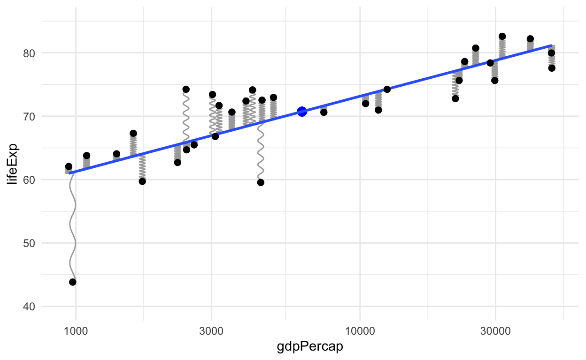
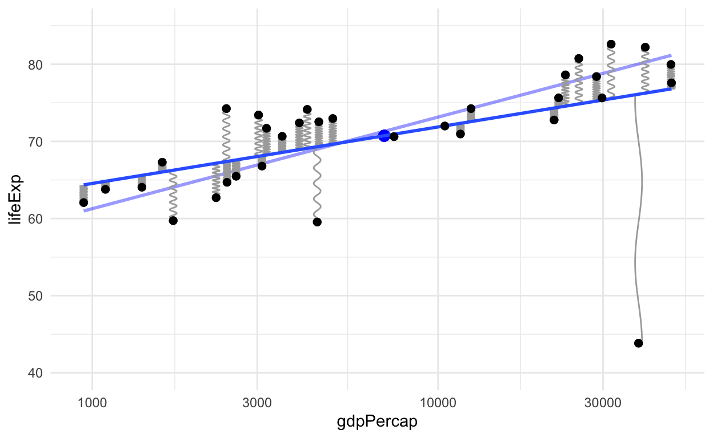
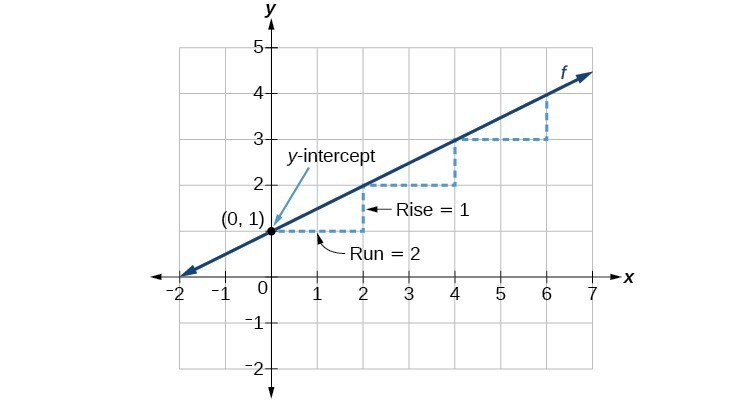
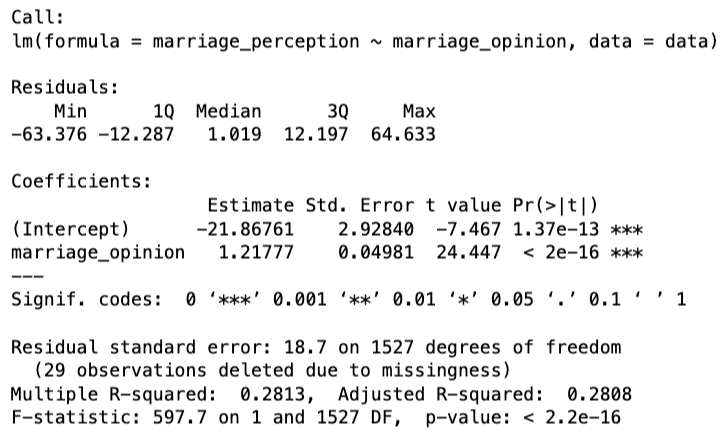
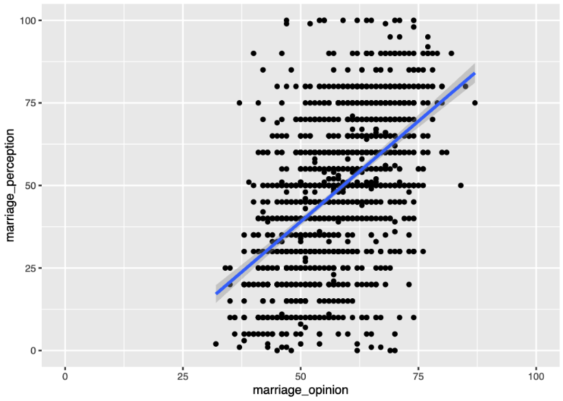



## Remember back to Week 3...

- Visualizing our data is extremely important!
- Plotting a "line of best fit" is often useful.
- Today: how to calculate a line of best fit
- aka **bivariate regression.**
  - bivariate: two variables (X and Y)
  - regression: actually a long and unnecessary story
  
## Formal definition

**Bivariate regression line:** the line that minimizes the square of the vertical distances between the line and each of the points.



## Outliers exert disproportionate influence



## Getting the formula for the line

- Formula for any line: $y = mx + b$
  - $y$: our outcome of interest, aka our dependent variable
  - $x$: our independent variable
  - $b$: $y$-intercept of the line of best fit; outcome when $x=0$
  - $m$: slope of the line of best fit
- $m$ is often our quantity of interest: *for a one-unit increase in $x$, what is the corresponding change in $y$?*

## For example



:::{.fragment}
We can use this formula to estimate $y$ for any value of $x$.
:::

## Getting the formula from R

We run this command:

```{r, eval = F, echo = T}
summary(lm(y.variable ~ x.variable, data = data))
```

- `lm()` is the command for "linear (regression) model"
- wrapping in `summary()` gives you more detailed output
- `y.variable` is our "outcome" or "dependent variable"
- `x.variable` is our "predictor" or "independent variable"
- `data` is the name of the dataset

## Data example

```{webr}
suppressMessages(library(ggplot2))
data <- read.csv("broockman_skovron.csv")
head(data)
```

## The codebook

```{r}
library(knitr)
library(kableExtra)

vars <- data.frame(
  Variable = c(
    "republican", "incumbent",
    "marriage_perception", "marriage_opinion",
    "religexempt_perception", "religexempt_opinion",
    "gunsbanassault_perception", "gunsbanassault_opinion"
  ),
  Description = c(
    "Party of the survey respondent (1 = Republican, 0 = Democrat)",
    "Office status of the respondent (1 = incumbent, 0 = candidate)",
    "Respondent's estimate of the percent of constituents who support same-sex marriage",
    "Actual percent of constituents who support same-sex marriage",
    "Respondent's estimate of the percent of constituents who support a religious exemption from covering birth control",
    "Actual percent of constituents who support a religious exemption from covering birth control",
    "Respondent's estimate of the percent of constituents who support a ban on assault weapons",
    "Actual percent of constituents who support a ban on assault weapons"
  )
)

kable(vars, format = "html", col.names = c("Variable", "Description")) %>%
  kable_styling(font_size = 18, full_width = FALSE) %>%
  column_spec(1, monospace = TRUE, width = "3.5cm") %>%
  column_spec(2, width = "9cm")
```

## Do legislators know where their constituents stand on same-sex marriage?

```{webr}
#| warning: false
ggplot(data, aes(x = marriage_opinion, y = marriage_perception)) +
  geom_point() +
  geom_smooth(method = "lm") + # linear model again!!
  xlim(0, 100)
```

## Now let's find the formula for the line

```{webr}
summary(lm(marriage_perception ~ marriage_opinion, data))
```

  
## Interpreting the output {.smaller}

:::{.columns}
:::{.column width=50%}

:::
:::{.column width=50%}
- `(Intercept)`: the y-intercept of the line of best fit (the $b$)
  - What would it mean for `marriage_opinion` to be equal to 0?
  - Given the nature of our data, does this number even make sense?
- `marriage_opinion`: the slope of the line of best fit (the $m$)
  - aka the **coefficient on `marriage_opinion`**
- We can quantify our uncertainty about each of these estimates!
  
:::
:::
  
## Using this formula

What is our best guess for what percent of politicians think their constituents support gay marriage in a district where **50%** of voters actually *do* support gay marriage?

```{webr}
# (Intercept) Estimate: -21.86761
# marriage_opinion Estimate: 1.21777

best.guess.at.50 <- 
```

## Looks about right!



## Do not extrapolate


Can our data say anything about hypothetical districts where `marriage_opinion` = 0?

## Regression is a powerful tool...

- For summarizing relationships between variables
- For estimating likely values of $y$ for a given $x$
- But it's not magical --- you can't use regression to make inferences your data don't cover!

# Notebook time