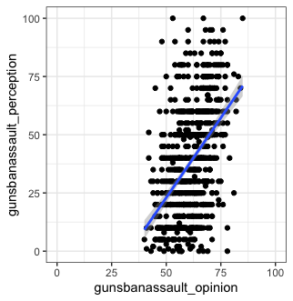
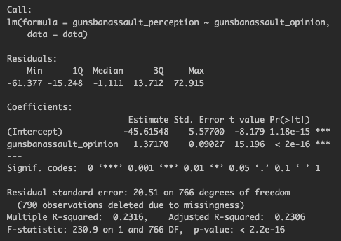
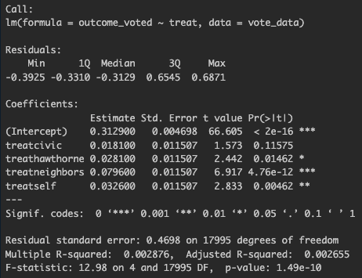
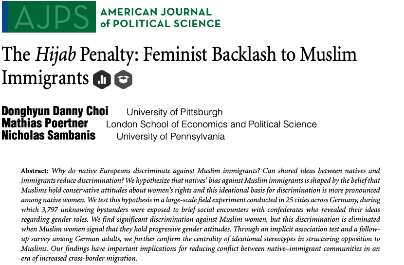
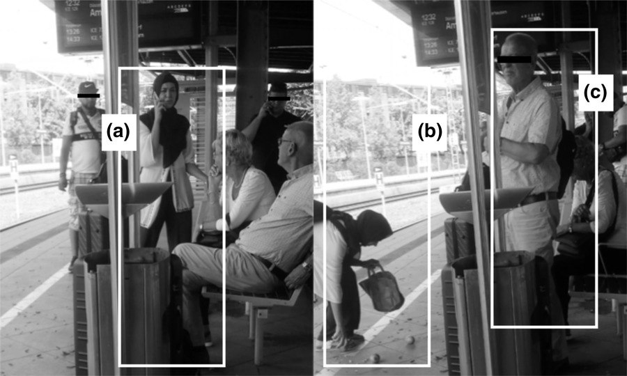



## Reminders

- Research report drafts are due on Brightspace **tomorrow**
  - Detailed instructions are posted on [Brightspace](https://docs.google.com/document/d/1Z8P7PRylnem_80WCK1jyrQAhdzVqMWVq9F9EQz_xbDE/edit?tab=t.0#heading=h.bem177sg4fo0)
- No class next week --- happy Thanksgiving!

```{r}
pacman::p_load(
  dplyr,
  tidyr,
  ggplot2,
  modelsummary,
  kableExtra
)

data <- read.csv("broockman_skovron.csv") %>%
  select(contains("guns"), republican) %>%
  drop_na()

write.csv(data, "temp.csv")
```

## Regression recap {.smaller}

- **Regression:** a mathematical process for creating a line of best fit for an $x$ variable and a $y$ variable
- We are covering just one form: **bivariate, ordinary least squares** regression
  - Minimizes the sum of the squared distances between each point and the line of best fit
  - Assumes the relationship between $x$ and $y$ is **linear**
- **Regression coefficient:** the slope of the line of best fit ($m$, more traditionally labeled as $\beta$), usually our quantity of interest
  - "For a one-unit change in $x$, what is the corresponding expected change in $y$?"
  
## Interpreting regression output

:::{.columns}
:::{.column width=40%}

:::
:::{.column width=60%}

:::
:::

## Today

1. Reading regression tables
2. Regression and correlation
3. Analyzing experiments with regression


## Reading a regression table {.smaller}

:::{.columns}
:::{.column width=50%}
```{r}
modelsummary(models = list(
  "All legislators" = lm(gunsbanassault_perception ~ gunsbanassault_opinion, data),
  "Democratic legislators" = lm(gunsbanassault_perception ~ gunsbanassault_opinion, data[data$republican==0,]),
  "Republican legislators" = lm(gunsbanassault_perception ~ gunsbanassault_opinion, data[data$republican==1,])
),
stars = T,
gof_map = c("nobs", "r.squared"),
coef_map = c("gunsbanassault_opinion" = "Actual district opinion",
             "(Intercept)" = "Intercept"),
title = "Relationship between district opinion on banning assault weapons and legislator's perception of district opinion.",
notes = c("Outcome variable is legislator's perception of their district's opinion. Each observation is one legislator-district pair. Both variables are scaled from 0 to 100. The column headings show the subset of the data on which the regression was run.")) |>
  tinytable::style_tt(fontsize = 0.6)
```
:::
:::{.column width=50%}
- Each column reports results from one regression
- Each row represents a term in the formula
- Top number: the **estimate**
- (Bottom number): the **standard error**
- Stars: **statistical significance**
- Num.Obs.: the number of observations
- R2: the square of the **correlation coefficient**
:::
:::

## What's a correlation coefficient, you ask?

- **Correlation:** a measure of how closely $x$ and $y$ move together along a straight line
- Traditionally denoted as $R$
- Ranges from -1 to 1
  - $\pm 1$: points fall exactly on a line that slopes up (+) or down (-)
  - 0: no linear relationship between $x$ and $y$
- *NOT THE SAME THING* as a regression coefficient!

## The correlation of opinion and perception

```{webr}
data <- read.csv("broockman_skovron.csv")
cor(data$gunsbanassault_opinion, data$gunsbanassault_perception, use = "complete")
```

## Regression vs. correlation coefficients

```{r}
df <- read.csv("example_datasets.csv") %>%
  mutate(dataset = factor(
    dataset,
    levels = c("original",
               "stronger_r_same_slope", "weaker_r_same_slope",
               "steeper_slope_same_r", "flatter_slope_same_r"),
    labels = c("'Actual data'",
               "'Stronger'~italic(R)*', same'~beta",
               "'Weaker'~italic(R)*', same'~beta",
               "'Same'~italic(R)*', larger'~beta",
               "'Same'~italic(R)*', smaller'~beta")
  ))

stats <- df %>%
  group_by(dataset) %>%
  summarise(
    beta = coef(lm(gunsbanassault_perception ~ gunsbanassault_opinion))[2],
    r    = cor(gunsbanassault_opinion, gunsbanassault_perception)
  ) %>%
  mutate(label = sprintf("beta == '%.2f'~~~italic(R) == '%.2f'", beta, r))

ggplot(df, aes(x = gunsbanassault_opinion, y = gunsbanassault_perception)) +
  geom_point() +
  geom_smooth(method = "lm", formula = y ~ x) +
  geom_text(data = stats,
            aes(x = -Inf, y = Inf, label = label),
            parse = TRUE, hjust = -0.05, vjust = 1.5,
            inherit.aes = FALSE) +
  facet_wrap(~dataset, labeller = label_parsed, ncol = 3) +
  labs(x = "Opinion", y = "Perception") +
  theme_bw() +
  theme(text = element_text(size = 18))
```

## When correlation coefficients matter

- In practice, not very often
- Very small correlation coefficients are common in social scientific research
- Main takeaway: correlation and regression coefficients both tell us about the relationship between $x$ and $y$, *but they tell us different things:*
  - $\beta$: the slope of the line of best fit
  - $R$: where the data points fall in relation to the line
  
## Last thing: experiments and regression

```{r}
#| echo: false
library(knitr)
library(kableExtra)

design <- data.frame(
  Condition = c("Control", "Civic Duty", "Hawthorne", "Self", "Neighbors"),
  mailed  = c("",  "X", "X", "X", "X"),
  watched = c("",  "",  "X", "X", "X"),
  own     = c("",  "",  "",  "X", "X"),
  allnbr  = c("",  "",  "",  "",  "X"),
  turnout = c("31.29", "33.10", "34.10", "34.55", "39.25"),
  stringsAsFactors = FALSE
)

kable(design, format = "html", escape = FALSE,
      align = c("l", "c", "c", "c", "c", "c"),
      col.names = c("Condition",
                    "Mailed reminder<br>to vote?",
                    "Told turnout<br>being watched",
                    "Given own<br>vote history",
                    "Neighbors &amp; self given<br>all neighbors'<br>vote history",
                    "Turnout %")) |>
  kable_styling(bootstrap_options = c("striped", "condensed"),
                full_width = FALSE, position = "center", font_size = 22) |>
  column_spec(1, bold = TRUE) |>
  column_spec(2:5, width = "3cm")
```

## We can do regression with non-numeric $x$ variables!

```{webr}
vote_data <- read.csv("social_pressure_str.csv")
summary(lm(outcome_voted ~ treat, vote_data))
```

## Where'd the control group go?

:::{.columns}
:::{.column width=45%}

:::
:::{.column width=55%}
- It's the **omitted category**
- This means the `(Intercept)` value = voter turnout in the control group
:::
:::

## Interpreting experimental $\beta$s {.smaller}

:::{.columns}
:::{.column width=45%}

:::
:::{.column width=55%}
```{r}
#| echo: false
library(knitr)
library(kableExtra)

design <- data.frame(
  Condition = c("Control", "Civic Duty", "Hawthorne", "Self", "Neighbors"),
  mailed  = c("",  "X", "X", "X", "X"),
  watched = c("",  "",  "X", "X", "X"),
  own     = c("",  "",  "",  "X", "X"),
  allnbr  = c("",  "",  "",  "",  "X"),
  turnout = c("31.29", "33.10", "34.10", "34.55", "39.25"),
  stringsAsFactors = FALSE
)

kable(design, format = "html", escape = FALSE,
      align = c("l", "c", "c", "c", "c", "c"),
      col.names = c("Condition",
                    "Mailed reminder<br>to vote?",
                    "Told turnout<br>being watched",
                    "Given own<br>vote history",
                    "Neighbors &amp; self given<br>all neighbors'<br>vote history",
                    "Turnout %")) |>
  kable_styling(bootstrap_options = c("striped", "condensed"),
                full_width = TRUE, position = "center", font_size = 15) |>
  column_spec(1, bold = TRUE)
```

Each estimate = increase *from intercept* resulting from receiving that mailer
:::
:::

## A more efficient way to calculate differences in means

:::{.columns}
:::{.column width=45%}

:::
:::{.column width=55%}
```{webr}
suppressMessages(library(estimatr))
difference_in_means(outcome_voted ~ treat,
                    vote_data,
                    condition1 = "0control",
                    condition2 = "civic")
```
:::
:::

## Introducing today's dataset



## The experiment

1. Female research confederate approaches a bench at a train station and draws their attention by asking them a question about buying tickets
2. Shortly thereafter, she receives a phone call and audibly converses with the caller regarding her sister
3. At the end of the call, a bag she is holding tears, causing her to drop a number of lemons that scatter around the platform
4. Other research confederates record whether bystanders helped her retrieve her lemons

## The scene



## The treatment

Two parts: gender attitudes and identity of the confederate


:::{.columns}
:::{.column width=33%}
**Neutral control:** conversation is not about gender attitudes
:::
:::{.column width=33%}
**Progressive condition:** confederate approves of her sister's decision to get a job instead of being a stay-at-home mom
:::
:::{.column width=33%}
**Regressive condition:** confederate disapproves of her sister's decision to get a job instead of being a stay-at-home mom
:::
:::

## The research confederates


## The data

```{r}
#| echo: false
library(tidyverse)
library(knitr)
library(kableExtra)

vars <- tribble(
  ~Value, ~Description,
  "<code>\"German\"</code>",
    "The person who dropped the lemons was a native German who made a call (implying one of several gender attitudes I have collapsed into one category to make the data analysis easier).",
  "<code>\"Imm w/ Hijab, Conservative Gender Att\"</code>",
    "The person who dropped the lemons was an immigrant wearing a hijab and made a call implying they had conservative gender attitudes.",
  "<code>\"Imm w/ Hijab, Neutral Gender Att\"</code>",
    "The person who dropped the lemons was an immigrant wearing a hijab and made a call that did not imply anything about their gender attitudes.",
  "<code>\"Imm w/ Hijab, Progressive Gender Att\"</code>",
    "The person who dropped the lemons was an immigrant wearing a hijab and made a call implying they had progressive gender attitudes.",
  "<code>\"Imm w/o Hijab\"</code>",
    "The person who dropped the lemons was an immigrant who did not wear a hijab (implying one of several gender attitudes I have collapsed into one category to make the data analysis easier).",
  "<code>anyhelp</code>",
    "<strong></strong> Binary indicator for whether any bystander offered help"
)

vars %>%
  kable(format = "html", escape = FALSE,
        col.names = c("Value", "Description")) %>%
  kable_styling(font_size = 18, full_width = TRUE) %>%
  pack_rows("treat:", 1, 5) %>%
  pack_rows("anyhelp:", 6, 6) %>%
  column_spec(1, width = "30%")
```

# Notebook time!

```{r include = F, eval = F}
# make table for inclusion in notebook

dat <- read.csv("phonecall_clean_lecture.csv") %>%
  mutate(genderatt = gsub("Neutral", "0Neutral", genderatt))

modelsummary(models = list("All trials" = lm(anyhelp ~ genderatt, dat),
                           "Majority of bystanders were women" = lm(anyhelp ~ genderatt, dat[dat$femprop > 0.5,]),
                           "Majority of bystanders were men" = lm(anyhelp ~ genderatt, dat[dat$femprop < 0.5,])),
             stars = T,
             gof_map = c("nobs", "r.squared"),
             coef_map = c("genderattConservative" = "Conservative gender attitudes",
                          "genderattProgressive" = "Progressive gender attitudes",
                          "(Intercept)" = "Intercept"),
             title = "Bystander intervention by gender attitudes expressed by research confederate",
             notes = "Outcome variable is a binary indicator for whether any bystanders helped. Each observation is one trial. The column headings show the subset of the data on which the regression was run.")
```