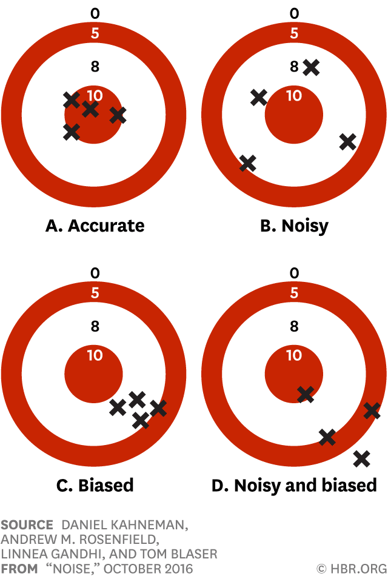
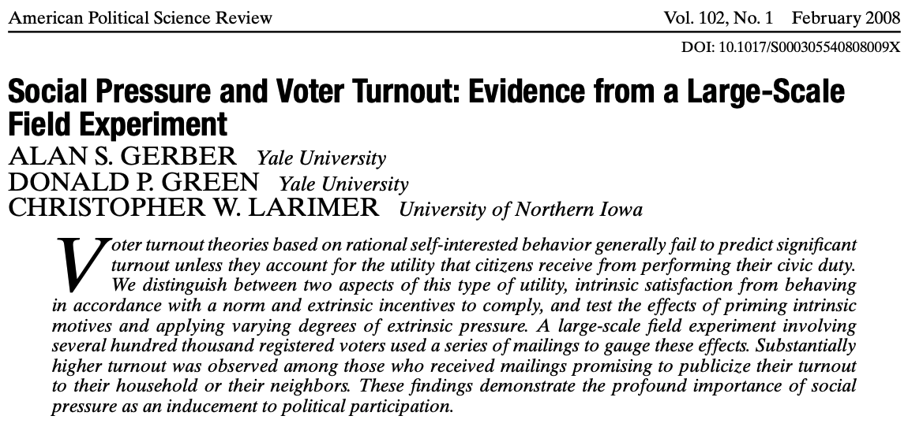




## Recap

- *Defining* causality is easy
  - The difference between a unit's **potential outcomes**
- BUT we must contend with the **fundamental problem of causal inference**
- Establishing causality *in practice* is extremely difficult
  - **Reverse causation**
  - **Omitted variable bias**
    - **Selection bias**

## Check your understanding

> What does it mean to say that potential outcomes are both **hypothetical** and **true?**

## So what can we do?

- FPCI $\rightarrow$ we can never directly observe causal relationships at the **individual** level
- BUT we can estimate *average* treatment effects across groups of people!
- Let's revisit this with our (real) wellness dataset.

## The data

```{webr}
wellness <- read.csv("wellness.csv")
head(wellness)
```

## Codebook

```{r}
#| echo: false
library(knitr)
library(kableExtra)
wellness <- read.csv("wellness.csv")


codebook <- data.frame(
  Variable = c("id", "treat", "participate", "baseline", "outcome_post"),
  Description = c(
    "Respondent identifier",
    "0 = randomly assigned NOT to be allowed to participate; 1 = assigned TO be allowed to participate",
    "0 = did not participate in the wellness program; 1 = did participate",
    "Average monthly medical costs at baseline (before the program started)",
    "Monthly medical cost after the program started"
  ),
  stringsAsFactors = FALSE
)

kable(codebook, format = "html", escape = FALSE, align = "ll") |>
  kable_styling(bootstrap_options = c("striped", "condensed"),
                full_width = FALSE, position = "center", font_size = 24) |>
  column_spec(1, monospace = TRUE, bold = TRUE) |>
  column_spec(2, width = "32em")
```

## You compared outcomes between participants and non-participants

```{webr}
non.participant.mean <- mean(subset(wellness, treat == 1 & participate == 0)$outcome_post)
participant.mean <- mean(subset(wellness, treat == 1 & participate == 1)$outcome_post)
participant.mean - non.participant.mean
```

## At the end of the notebook, we examined outcomes between treated and non-treated employees

```{webr}
non.treated.mean <- mean(subset(wellness, treat == 0)$outcome_post)
treated.mean <- mean(subset(wellness, treat == 1)$outcome_post)
treated.mean - non.treated.mean
```

## The study's findings

> We find strong patterns of selection: during the year prior to the intervention, program participants had lower medical expenditures and healthier behaviors than nonparticipants. ... we do not find significant causal effects of treatment on total medical expenditures.

## Randomization solves selection bias

- Problem you found last week: people who *chose* to join the wellness program were different at baseline.
- In other words, **their potential outcomes were not the same.**
- Example of **selection bias:** systematic differences between "treated" and "non-treated" units
- But with random assignment, *we* are doing the selecting!
  - **In expectation,** our treatment and control groups have identical potential outcomes.
  
## Effect of treatment vs. effect of participation

- Tradeoff: not everyone who is *allowed* to join the program will actually participate $\rightarrow$ treatment effect $\neq$ effect of participation
- Effect of treatment turned out to be much smaller
- BUT these two "effects" mean different things! Which one is actually more important?

## Randomization actually solves *all* forms of omitted variable bias

- What if some other variable $Z$ determined **both** $X$ (treatment) and $Y$ (outcome)?
- But *we* determined $X$ --- so it's virtually impossible for it to be caused by $Z$ *as long as assignment to treatment is truly random.*

## Scenario 1

> To pilot a new corporate wellness program, a company decides that all new hires moving forward will be invited to join the program. Healthcare spending will then be compared between new hires and longstanding employees to determine the effect of the wellness program.

- Is assignment to treatment truly random?
- What variable(s) might create omitted variable bias in this scenario?

## Scenario 2

> To pilot a new corporate wellness program, a company holds a raffle for program vouchers for their employees. Tickets for the raffle are handed out to employees who complete a local 5k that the company is sponsoring. Healthcare spending will then be compared between raffle winners and all other employees to determine the effect of the wellness program.

- Is assignment to treatment truly random?
- What variable(s) might create omitted variable bias in this scenario?

## What if the groups randomly turn out to have different potential outcomes?

```{r}
names <- c("Olivia", "Katie", "Ashlynd", "Camille", "Christina", "Ivy")
attended <- c("Runs for office", "Runs for office", "Runs for office", "Runs for office", "Does not run", "Does not run")
didnt <- c("Runs for office", "Runs for office", "Does not run", "Does not run", "Does not run", "Does not run")
kable(cbind(names, attended, didnt),
      col.names = c("Person", "Attends training", "Does not attend training"),
      align = "cccc") %>%
  column_spec(1, width = "1.5cm") %>%
  column_spec(2, color = c("white", "white", "white", "white", "white", "white"), background = c("green", "green", "green", "green", "grey20", "grey20"), width = "6cm") %>%
  column_spec(3, color = c("white", "white", "white", "white", "white", "white"), background = c("green", "green", "grey20", "grey20", "grey20", "grey20"), width = "6cm") %>%
  add_header_above(c(" " = 1, "Potential outcomes" = 2)) %>%
  kable_styling(font_size = 28)
```

## A note on sample size

- **Sample:** the units being studied
- **Population:** all of the units the study seeks to describe or understand
- The bigger the **sample size,** the the study groups will resemble the population AND each other.
  - IF the sample is representative and the study design does not introduce other sources of bias!

# So if randomly-assigned groups *do* differ in some important way, what do we call that?


---

:::{.columns}
:::{.column width=50%}

:::
:::{.column width=50%}
- Say we do the same experiment 4 times
- Selection bias $\rightarrow$ bias (obvi)
- Small, unlucky samples $\rightarrow$ noise/error
- *But the average of the unlucky samples is still a bullseye!*
:::
:::

## This week's dataset



## The treatment


## An aside about potential outcomes

```{r}
names <- c("Chris", "James", "Gordon", "Mark")
control <- c("Does not vote", "Does not vote", "Votes", "Votes")
treatment <- c("Votes", "Does not vote", "Votes", "Does not vote")
kable(cbind(names, control, treatment),
      col.names = c("Person", "Control", "Neighbors treatment"),
      align = "cccc") %>%
  column_spec(1, width = "1.5cm") %>%
  column_spec(2, color = c("white", "white", "white", "white"), background = c("grey20", "grey20", "green", "green"), width = "6cm") %>%
  column_spec(3, color = c("white", "white", "white", "white"), background = c("green", "grey20", "green", "grey20"), width = "6cm") %>%
  add_header_above(c(" " = 1, "Potential outcomes" = 2)) %>%
  kable_styling(font_size = 28)
```

:::{.fragment}
Always remember that individual treatment effects may vary!
:::

## Let's look at the data

```{webr}
social <- read.csv("social_pressure.csv")
head(social)
```

## Codebook

```{r}
#| echo: false
library(knitr)
library(kableExtra)

codebook <- data.frame(
  Variable = c(
    "outcome_voted",
    "control_group", "treat_neighbors",
    "sex", "yob", "g2000", "g2002", "median_income", "p2004", "democrat"
  ),
  Description = c(
    "1 if the person voted, 0 if not",
    "1 if assigned to the control group, 0 otherwise",
    "Mail with own and neighbors' voting history: 1 if assigned, 0 otherwise",
    "Female or male",
    "Year of birth",
    "Voted in the 2000 general election",
    "Voted in the 2002 general election",
    "Median income over the last 12 months in the person's neighborhood",
    "Voted in the 2004 primary election",
    "Registered Democrat"
  ),
  stringsAsFactors = FALSE
)

kable(codebook, format = "html", align = "ll") |>
  kable_styling(bootstrap_options = c("striped", "condensed"),
                full_width = FALSE, position = "center", font_size = 22) |>
  column_spec(1, monospace = TRUE, bold = TRUE)
```

## Let's check out the balance of some key variables

```{webr}
mean(subset(social, treat_neighbors == 1)$sex== "female") - 
  mean(subset(social, treat_neighbors == 0)$sex == "female") # gender balance

mean(subset(social, treat_neighbors == 1)$democrat) - 
  mean(subset(social, treat_neighbors == 0)$democrat) # party balance

mean(subset(social, treat_neighbors == 1)$p2004) - 
  mean(subset(social, treat_neighbors == 0)$p2004) # voted in last election
```

# Your turn