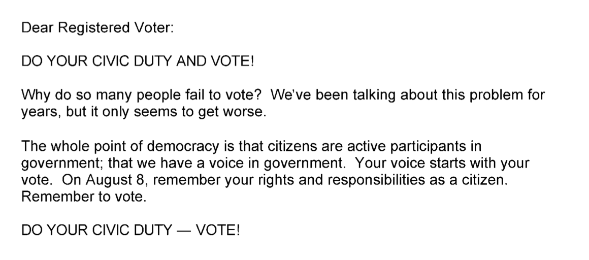
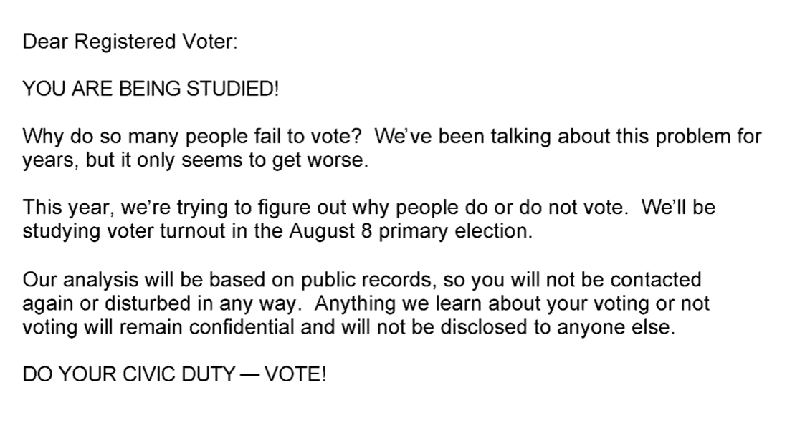
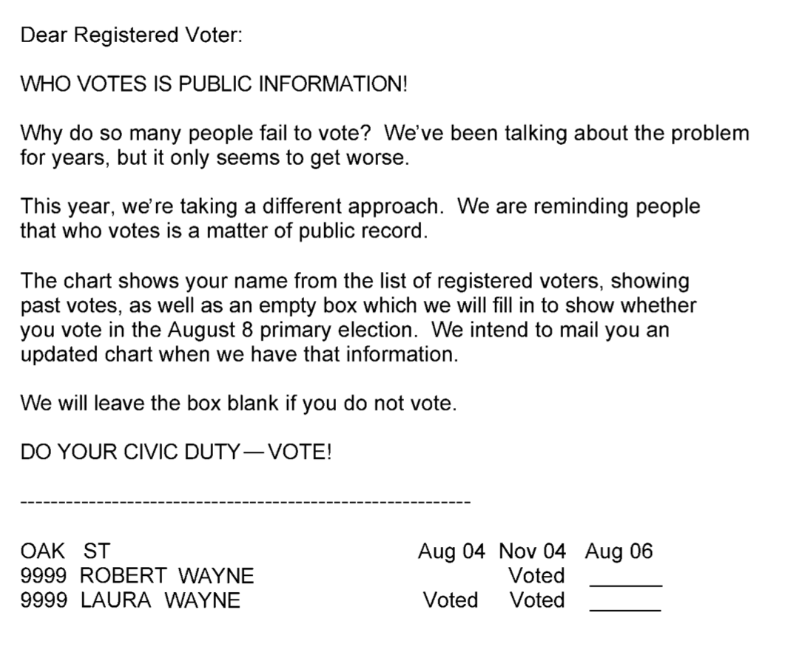
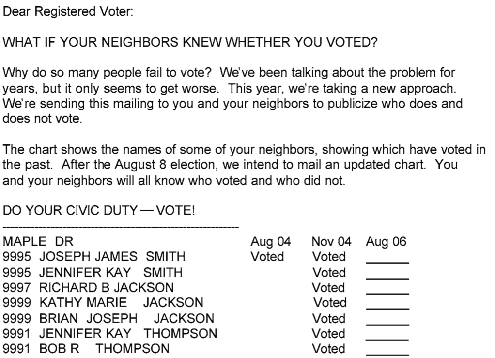



## Assignment reminders

- Problem Set 2 due tomorrow
- Next research project deadline: survey ready or data collected by Friday, October 30 (week after next!)
- **Today in class:** discuss which research proposal you will pursue with your group; finalize with me either today or Tuesday

## Back to the social pressure study

- On Tuesday, you analyzed the effect of the *strongest* treatment
- But the researchers tested several others...

## Civic duty treatment



## Hawthorne treatment



## Self treatment



## Neighbors treatment



## One dataset, many interesting comparisons

```{r}
#| echo: false
library(knitr)
library(kableExtra)

design <- data.frame(
  Condition = c("Control", "Civic Duty", "Hawthorne", "Self", "Neighbors"),
  mailed  = c("",  "X", "X", "X", "X"),
  watched = c("",  "",  "X", "X", "X"),
  own     = c("",  "",  "",  "X", "X"),
  allnbr  = c("",  "",  "",  "",  "X"),
  turnout = c("31.29", "33.10", "34.10", "34.55", "39.25"),
  stringsAsFactors = FALSE
)

kable(design, format = "html", escape = FALSE,
      align = c("l", "c", "c", "c", "c", "c"),
      col.names = c("Condition",
                    "Mailed reminder<br>to vote?",
                    "Told turnout<br>being watched",
                    "Given own<br>vote history",
                    "Neighbors &amp; self given<br>all neighbors'<br>vote history",
                    "Turnout %")) |>
  kable_styling(bootstrap_options = c("striped", "condensed"),
                full_width = FALSE, position = "center", font_size = 22) |>
  column_spec(1, bold = TRUE) |>
  column_spec(2:5, width = "3cm")
```

:::{.fragment}
The most useful **baseline** isn't always the **control group!**
:::

# A new R command for comparing outcomes across groups

## Old way to compute effect of Hawthorne mailer

```{webr}
social <- read.csv("social_pressure_str.csv")
hawthorne.subset <- subset(social, treat == "hawthorne")
control.subset <- subset(social, treat == "control")
hawthorne.effect <- mean(hawthorne.subset$outcome_voted) - mean(control.subset$outcome_voted)
hawthorne.effect
```

## Introducing `difference_in_means()` {.smaller}

The generic recipe: `difference_in_means(outcome.name ~ treatment.name, dataset.name, condition1 = 'baseline.condition', condition2 = 'treatment.condition')`

Replace:

- `outcome.name` with the dependent variable
- `treatment.name` with the treatment variable
- `dataset.name` with the name of the dataset
- `'baseline.condition'` with the *value* of the treatment variable corresponding with the *baseline* condition
- `'treatment.condition'` with the *value* of the treatment variable corresponding with the condition you're trying to estimate the effect of
- (note the quotation marks in the last two!)

## Let's calculate the effect of the Hawthorne mailer

```{webr}
library(estimatr) # package that includes the command
hawth_effect <- difference_in_means(outcome_voted ~ treat, social, condition1 = 'control', condition2 = 'hawthorne')
hawth_effect
```

## Advantages of this approach

- One line of code
- Gives you lots of additional useful info (we'll start covering this next week)
- Easy to look at different comparisons...

## Reminder: what does the estimate mean?

- We found an estimate of 0.0281
- This is our **best guess of the true average treatment effect**
- FPCI: we can never know individual treatment effects OR the exact true average treatment effect
- Estimating using a randomized experiment is the closest we can get

## Comparing two treatment conditions

```{r}
#| echo: false
library(knitr)
library(kableExtra)

design <- data.frame(
  Condition = c("Control", "Civic Duty", "Hawthorne", "Self", "Neighbors"),
  mailed  = c("",  "X", "X", "X", "X"),
  watched = c("",  "",  "X", "X", "X"),
  own     = c("",  "",  "",  "X", "X"),
  allnbr  = c("",  "",  "",  "",  "X"),
  turnout = c("31.29", "33.10", "34.10", "34.55", "39.25"),
  stringsAsFactors = FALSE
)

kable(design, format = "html", escape = FALSE,
      align = c("l", "c", "c", "c", "c", "c"),
      col.names = c("Condition",
                    "Mailed reminder<br>to vote?",
                    "Told turnout<br>being watched",
                    "Given own<br>vote history",
                    "Neighbors &amp; self given<br>all neighbors'<br>vote history",
                    "Turnout %")) |>
  kable_styling(bootstrap_options = c("striped", "condensed"),
                full_width = FALSE, position = "center", font_size = 22) |>
  column_spec(1, bold = TRUE) |>
  column_spec(2:5, width = "3cm")
```

- Theory: telling people they are being studied has a big effect on their behavior (this is called the *Hawthorne Effect!*)
- What would be wrong with testing this theory by comparing the `hawthorne` and `control` groups?

## Let's compare the `hawthorne` and `civic` conditions instead

```{webr}
# difference_in_means(outcome.name ~ treatment.name, dataset.name, condition1 = 'baseline.condition', condition2 = 'treatment.condition')
hawth_vs_civic <- 
hawth_vs_civic
```

## Now let's compare the `civic` and `control` conditions

```{webr}
# difference_in_means(outcome.name ~ treatment.name, dataset.name, condition1 = 'baseline.condition', condition2 = 'treatment.condition')
civic_effect <- 
civic_effect / hawth_effect
```

# Your turn
