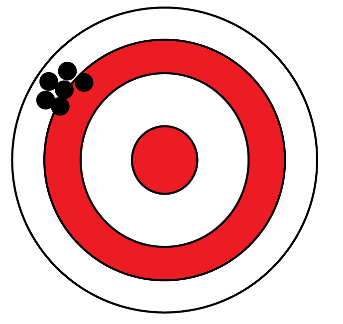
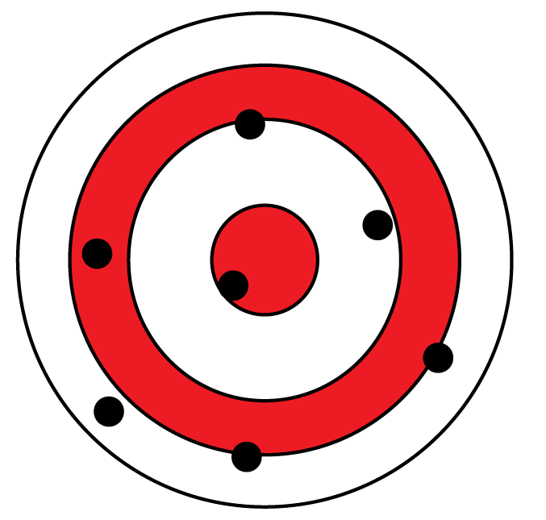
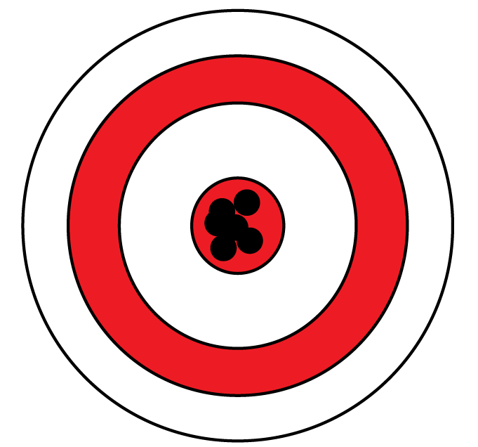
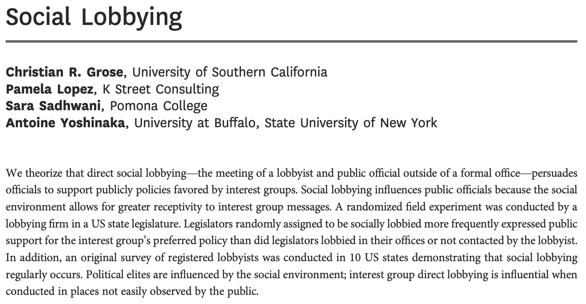



## Recap

- **Fundamental Problem of Causal Inference** $\rightarrow$ we can never observe causal effects directly
- We can only *estimate average* effects
- To do that, we have to be able to argue that our units' potential outcomes are comparable
  - **Selection bias** threatens this
  - But random assignment solves selection bias!
- BUT we can still draw an unlucky sample...

## Bias

:::{.columns}
:::{.column width=50%}

:::
:::{.column width=50%}
:::{.fragment}
If we compare women who **do** and **do not opt in** to candidate preparedness training to study the effect of the training, our estimates will always be wrong in the same way.
:::
:::{.fragment}
Randomized experiments do not have bias!
:::
:::
:::

## Experiments *do* have noise

:::{.columns}
:::{.column width=50%}

:::
:::{.column width=50%}
If we **randomly assign** women to attend or not, we might get a different answer each time we do the experiment due to chance.
:::
:::

## We can see this for ourselves

```{webr}
suppressMessages(library(estimatr)); set.seed(1027)

example.data <- data.frame(outcome = seq(from=0,to=1,length.out=10000),
                           treat = sample(c(0,1),10000, replace=TRUE))
difference_in_means(outcome ~ treat,
                    example.data, 
                    condition1 = 0, 
                    condition2 = 1)
```

## Obviously, we want something more like this

{fig-align="center"}

## How much noise does my experiment have?

:::{.columns}
:::{.column width=50%}

:::
:::{.column width=50%}

:::
:::

**Standard error:** A measure of how far off from the truth an experiment's answer usually is.

## Today's example: what kind of lobbying is most effective?



## The design

- Researchers worked with an education lobbying firm
- Study designed to test the effectiveness of **social lobbying**
- 119 Legislators randomly assigned to three groups:
  - Control group: no lobbying
  - Social lobbying group: met lobbyist at a restaurant or bar
  - Office lobbying: met lobbyist at their office
- Dependent variable: signing on to support a bill

## The data

```{r}
#| echo: false
library(knitr)
library(kableExtra)

codebook <- data.frame(
  Variable = c("caseid", "supportgroup", "treat", "ally", "female"),
  Description = c(
    "Identifier for each legislator / district",
    "<em>Outcome.</em> Whether the legislator agreed to list their name publicly as a sponsor of the bill",
    paste0("<em>Treatment.</em> Three values:<br>",
           "<code>control</code> = no contact from the lobbyist<br>",
           "<code>officelobby</code> = asked to meet in their office<br>",
           "<code>sociallobby</code> = asked to meet at a social location (restaurant or bar)"),
    "Lobbyist's rating of whether the legislator is an ally of the interest group (0, 1/3, 2/3, 1)",
    "Legislator gender: 1 = female, 0 = not"
  ),
  stringsAsFactors = FALSE
)

kable(codebook, format = "html", escape = FALSE, align = "ll") |>
  kable_styling(bootstrap_options = c("striped", "condensed"),
                full_width = FALSE, position = "center", font_size = 20) |>
  column_spec(1, monospace = TRUE, bold = TRUE,
              extra_css = "white-space: nowrap;") |>
  column_spec(2, width = "34em")
```

## Let's take a look

```{webr}
data <- read.csv("lobbying.csv")
head(data)
table(table$treat)
```

## Does social lobbying work?

```{webr}
difference_in_means(supportgroup ~ treat,
                    data,
                    condition1 = 'control',
                    condition2 = 'sociallobby')
```

## How big of a difference might we see by chance?

- For a moment, let's assume that the **true treatment effect** is zero
- In other words, each legislator's potential outcomes are the same whether they are lobbied or not
- But even in this world, our **estimated average treatment effect** would bounce around because of which legislators happen to be assigned to each group

## We can simulate this

```{webr}
# this function re-randomizes the treatment variable
re.randomize <- function(input.data) {
  input.data$treat <- sample(input.data$treat)
  return(input.data)
}

# this function computes the effect of social lobbying
compute.office.lobby.effect <- function(input.data) {
  estimate <- difference_in_means(supportgroup ~ treat,
                                  input.data,
                                  condition1 = 'control',
                                  condition2 = 'sociallobby')$coefficients
  return(as.numeric(estimate))
}
```

## We can simulate this

```{webr}
compute.office.lobby.effect(data) # actual estimate
# now let's simulate three estimates with re-randomized data
compute.office.lobby.effect(re.randomize(data))
compute.office.lobby.effect(re.randomize(data))
compute.office.lobby.effect(re.randomize(data))
```

## Let's simulate a *lot* of these

```{webr}
simulated.estimates <- replicate(10000, compute.office.lobby.effect(re.randomize(data)))
head(simulated.estimates)
library(ggplot2)
qplot(simulated.estimates, binwidth = .025) + 
  geom_vline(xintercept = compute.office.lobby.effect(data), color = 'red')
```

## The *standard error* describes the spread of this distribution.

```{r, echo = F, warning = F, message = F}
library(estimatr)
data <- read.csv("lobbying.csv")
re.randomize <- function(input.data) {
  input.data$treat <- sample(input.data$treat)
  return(input.data)
}

# this function computes the effect of social lobbying
compute.office.lobby.effect <- function(input.data) {
  estimate <- difference_in_means(supportgroup ~ treat,
                                  input.data,
                                  condition1 = 'control',
                                  condition2 = 'sociallobby')$coefficients
  return(as.numeric(estimate))
}
simulated.estimates <- replicate(10000, compute.office.lobby.effect(re.randomize(data)))
head(simulated.estimates)
library(ggplot2)
qplot(simulated.estimates, binwidth = .025) + 
  geom_vline(xintercept = compute.office.lobby.effect(data), color = 'red')
```

## Good news: `difference_in_means()` calculates it for you!

```{webr}
difference_in_means(supportgroup ~ treat, 
                    data, 
                    condition1 = 'control', 
                    condition2 = 'sociallobby')
# How big is the standard error relative to the estimate?
# let's divide estimate / standard error
```

## t-statistics

A measure of how likely it is that an estimate of the size we saw would arise by chance *even if the treatment had no effect.*

- Estimates are conventionally considered **statistically significant** if the t-statistic ($\frac{\text{Estimate}}{\text{Standard Error}}$) is larger than 1.96 (positive or negative)
- If $t \leq 1.96$ we conclude that our estimate could have arisen by chance
- More on this on Thursday...

## One more important statistic

- **Standard deviation:** the spread of the outcome variable within each treatment group
- If treatment and control groups are the same size and have the same standard deviation, then:
- $\text{Standard Error} = 2s\sqrt{\frac{1}{N}}$
  - What happens to the standard error if the standard deviation ($s$) doubles?
  - What happens to the standard error if the sample size ($N$) doubles?
  - By how much would we have to increase $N$ to make the standard error half its original size?

  
## Reviewing new terms and concepts

- **True average treatment effect:** the actual truth about what the causal effect of a treatment is, which would require us to see all the potential outcomes to calculate
- **Estimate:** from a particular study run one particular time, our best guess of what the true average treatment effect is
- **Bias:** when a study's estimates are systematically wrong in a particular direction
- **Noise:** when a study's estimate differs from the truth because of random chance
- **Standard error** A way of measuring *how much* a study's estimate will differ from the truth because of random chance. A measure of **noise.**
- **t-statistic:** The estimate divided by the standard error. Indicates how likely a study's result is to have arisen by chance.

  
## There is no analogous test for quantifying *bias.* Why not?

:::{.columns}
:::{.column width=33%}

:::
:::{.column width=33%}

:::
:::{.column width=33%}

:::
:::

# Notebook time