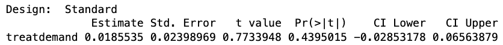



# First...

How is survey design/data collection going?
(email me your survey form/dataset by tomorrow night for full credit!)

## Recap {.smaller}

- We've learned to get three(ish) things from an experiment:
  - An **estimate:** our best guess of the average treatment effect
  - A **standard error:** a measure of how far off from the truth an experiment's estimate usually is
  - A **$p$-value:** the probability of seeing the estimate we did *if the treatment had no effect on the outcome*
- But even if our $p$-value is **statistically significant,** we know that the estimate is unlikely to be *exactly* right --- there will still be some **noise.**
- *How close is our estimate likely to be?*
- **Confidence intervals** give us an easily-interpretable indication.

## Confidence intervals

- A range of numbers that will contain the **true average treatment effect** a set percentage of the time (usually 95%).
- Consists of two numbers: a lower bound and an upper bound.
- The **confidence interval** is the range between these bounds, which we consider the **range of plausible estimates of the average treatment effect.**

:::{.fragment}
*In 95% of iterations of a given experiment, the confidence interval will contain the true average treatment effect.*
:::

## A motivating example: vaccine efficacy

```{r}
library(knitr)
library(kableExtra)

results <- data.frame(
  Group = c("Vaccine A", "Vaccine B"),
  Estimate = c("-90%", "-89%"),
  SE = c("30%", "2%"),
  p = c("0.001", "0.001")
)

kable(results, format = "html",
      col.names = c("", "Estimate", "Standard Error", "p-value"),
      align = c("l", "l", "l", "l")) %>%
  kable_styling(font_size = 25, full_width = FALSE)
```

- The $p$-value tells us whether the effect of the vaccine is statistically significant
- The estimate gives us our best guess of its effectiveness
- But which of these two vaccines would you want to take?

## Confidence intervals make interpretation easier

```{r}
library(knitr)
library(kableExtra)

results <- data.frame(
  Group = c("Vaccine A", "Vaccine B"),
  Estimate = c("-90%", "-89%"),
  SE = c("30%", "2%"),
  p = c("0.001", "0.001"),
  CI = c("[-100%, -31%]", "[-93%, -85%]")
)

kable(results, format = "html", escape = FALSE,
      col.names = c("", "Estimate", "Standard Error", "p-value",
                    "95% Confidence<br>Interval"),
      align = c("l", "l", "l", "l", "l")) %>%
  kable_styling(font_size = 25, full_width = FALSE) %>%
  column_spec(1, bold = TRUE) %>%
  row_spec(0, bold = TRUE, align = "c")
```

- What is the null hypothesis in a test of vaccine efficacy?
- What would skeptical Sarah (or her friend pessimistic Penelope) say about these confidence intervals?
- The bounds of our confidence interval are the most **optimistic** and most **pessimistic** plausible values.

## Calculating 95% confidence intervals

- Upper bound: $\text{Estimate} + 1.96 \times \text{Standard Error}$
- Lower bound: $\text{Estimate} - 1.96 \times \text{Standard Error}$
- This means:
  - The *middle* of the confidence interval is the estimate
  - The *width* of the confidence interval is determined by the standard error
  - Bigger sample size $\rightarrow$ smaller standard error $\rightarrow$ narrower confidence interval
  
## Interpreting confidence intervals

Imagine two experiments, one on Letter A and one on Letter B, trying to understand their effects on voter turnout:

```{r}
library(knitr)
library(kableExtra)

results <- data.frame(
  Experiment = c("Experiment 1: Letter A", "Experiment 2: Letter B"),
  Estimate = c("8%", "5%"),
  SE = c("30%", "1%"),
  CI = c("[-50%, 66%]", "[3%, 7%]")
)

kable(results, format = "html", escape = FALSE,
      col.names = c("Experiment", "Estimate", "Standard Error",
                    "95% Confidence<br>Interval"),
      align = c("l", "l", "l", "l")) %>%
  kable_styling(font_size = 23, full_width = FALSE) %>%
  column_spec(1, bold = TRUE) %>%
  row_spec(0, bold = TRUE, align = "c")
```

- Remember: bigger sample sizes $\rightarrow$ smaller standard error
- Experiment 1 must have had a really small sample size!
- We should **not** be more optimistic about Letter A just because the sample size of the experiment is smaller.

## Experiment on electing women {.smaller}

- In 2014, the Utah Republican Party wanted to encourage more women to be active in the Party
- They partnered with researchers at BYU to conduct an experiment:
  - **Precincts** hold conventions to select delegates to the state Republican convention
  - The researchers sent one of four letters to over 2,000 precinct chairs
- Treatments:
  - **Control:** letter did not mention women and running for state delegate
  - **Supply group:** letter instructed precinct chair to recruit 2-3 women to run as state delegate
  - **Demand group:** letter instructed precinct chair to read a message from the party at the precinct convention asking women to run
  - **Both group:** both the supply and demand messages above
- Dependent variables: the proportion of precinct delegates who were women + binary indicator for electing at least one woman

## The dataset

```{r}
library(knitr)
library(kableExtra)

vars <- data.frame(
  Variable = c(
    "unique_id", "treat", "'control'", "'supply'", "'demand'", "'both'",
    "prop_sd_fem2014", "sd_onefem2014", "county", "pc_male"
  ),
  Description = c(
    "Precinct ID",
    "Treatment variable",
    "Control group",
    "Supply group: party chair instructed to recruit 2-3 women",
    "Demand group: party chair reads letter at precinct convention",
    "Both treatments: party chair instructed to read letter <em>and</em> to recruit 2-3 women",
    "Proportion of 2014 elected state delegates from the precinct who were women",
    "1 if at least one woman was selected; 0 otherwise",
    "County name in Utah",
    "1 if precinct chair is male; 0 otherwise (the chair runs the precinct meeting and reads the letter if assigned)"
  )
)

kable(vars, format = "html", escape = FALSE,
      col.names = c("Variable", "Description")) %>%
  kable_styling(font_size = 16, full_width = FALSE) %>%
  column_spec(1, monospace = TRUE, width = "4.5cm") %>%
  column_spec(2, width = "11cm") %>%
  add_indent(3:6)
```

## Let's take a look

```{webr}
#| message: false
#| warning: false
suppressMessages(library(estimatr))
data <- read.csv("electing_women.csv")
head(data)
table(data$treat)
```

## Computing a 95% confidence interval

```{webr}
demand.vs.control.dim <- difference_in_means(prop_sd_fem2014 ~ treat,
                                             data,
                                             condition1 = 'control',
                                             condition2 = 'demand')
demand.vs.control.dim
```

## What this confidence interval means {.smaller}



- **Estimate:** our best guess is that the precinct chair reading the letter increased the proportion of women elected at a precinct convention by about 1.9 percentage points
- **CI Lower:** the lowest value that is *plausible* is a 2.9 percentage point *decrease*
- **CI Upper:** the highest value that is *plausible* is a 6.6 percentage point *increase*

## Retrieving the ends of the 95% confidence interval from `difference_in_means()`

```{webr}
demand.vs.control.95ci.high.end <- demand.vs.control.dim$conf.high
demand.vs.control.95ci.low.end <- demand.vs.control.dim$conf.low
demand.vs.control.estimate <- demand.vs.control.dim$coefficients
demand.vs.control.95ci.high.end
demand.vs.control.95ci.low.end
demand.vs.control.estimate
```

## Using confidence intervals

- Often the most intuitive way to explain a range of uncertainty to practitioners
- Can be used to answer questions like:
  - How many units need to be treated to change one outcome?
  - What is the cost per changed outcome?
  - **How many units would change outcomes if a certain number are treated?**
- Answering these questions is especially useful when resources are limited
  
## For example...

If we rolled out the "demand" treatment to 500 precincts, how many more precincts would we expect to elect at least one woman?

```{webr}
at.least.one.woman <- difference_in_means(sd_onefem2014 ~ treat,
                                          data,
                                          condition1 = 'control', 
                                          condition2 = 'demand')
at.least.one.woman
```

## Calculating the range of additional precincts electing at least one woman

$$
\small
\begin{aligned}
&\text{Expected N. units with different outcomes} \\
&= \text{N. units treated} \times \text{Estimated effect per unit}
\end{aligned}
$$

```{webr}
500 * at.least.one.woman$coefficients # our best guess
500 * at.least.one.woman$conf.low # most pessimistic plausible outcome
500 * at.least.one.woman$conf.high # most optimistic plausible outcome
```

## Summing up

- **Confidence interval:** a range of numbers that will contain the **true average treatment effect** some percentage of the time
  - The conventional percentage in political science is 95%
- `difference_in_means()` gives you the lower and upper bounds of a 95% confidence interval
- We consider the confidence interval to contain the **range of plausible estimates of the average treatment effect.**
- Useful for thinking about the most pessimistic and optimistic plausible outcomes of an intervention

# Notebook time